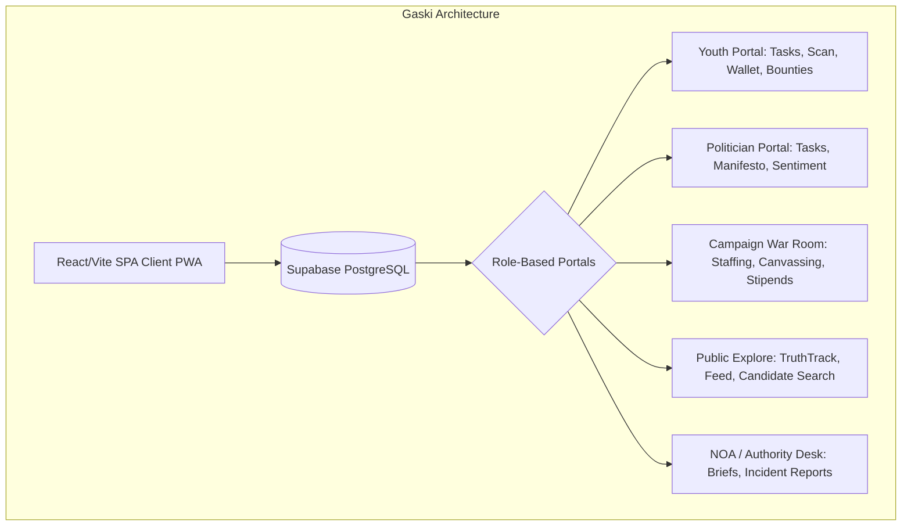
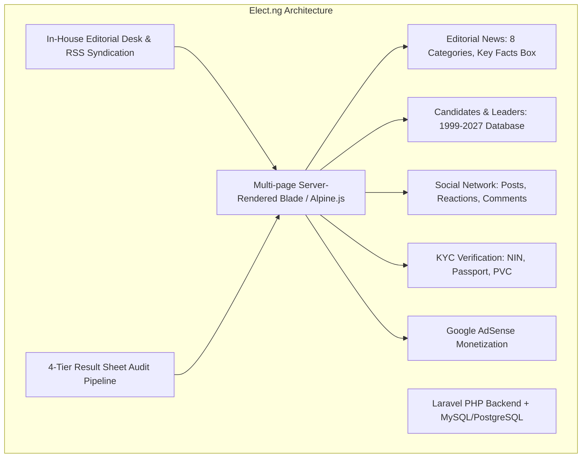
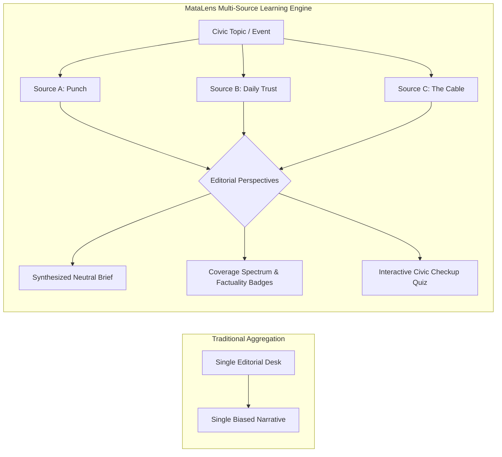

# Deep Research & Competitive Architecture Audit: Gaski.ng vs. Elect.ng
**Target Platform:** MataLens (Personal, Nonpartisan Political-Learning Companion for Nigerians)  
**Date:** November 2026  
**Investigator:** Antigravity Autonomous Research Subagent  
**Evidence Artifacts:** Stored in [`docs/design-planning/fetched/`](file:///c:/Users/USER/Desktop/matalens/docs/design-planning/fetched)

---

## Executive Summary

As MataLens pivots from a narrow civic camera/intake tool into a **personal, nonpartisan political-learning companion for Nigerian voters**, understanding the current landscape of Nigerian civic-tech and election monitoring platforms is critical.

This investigation provides a rigorous architectural, editorial, and UX audit of Nigeria's two most prominent upcoming 2027 election platforms:
1. **Gaski (`https://www.gaski.ng/`)**: A multi-role civic gig-economy and campaign intelligence platform built on Vite/React/Tailwind/Supabase (Lovable.dev origin), combining youth task bounties ("Verify. Mobilize. Earn.") with B2B political campaign war rooms, sentiment monitoring, and manifesto tracking.
2. **Elect.ng (`https://elect.ng/`)**: A voter social network and election results platform built on Laravel/Blade/Alpine.js/Tailwind, featuring an in-house editorial news desk, historical election databases dating back to 1999, candidate side-by-side comparisons, 4-tier result verification badges, and strict NIN/PVC identity verification.

### Core Strategic Verdict for MataLens
Both platforms validate the intense appetite among Nigerian youths for election transparency, candidate accountability, and verified result data. However, **both platforms suffer from fatal structural compromises**:
- **Elect.ng** falls into the "social network trap" (comments, reactions, follow counts) and introduces severe privacy barriers (requiring NIN/passport/PVC uploads), while relying on Google AdSense banner clutter.
- **Gaski** suffers from a **catastrophic conflict of interest**: it attempts to be a neutral fact-checker and manifesto watchdog while simultaneously selling private "War Room", canvassing, and sentiment analytics subscriptions to the political campaigns themselves. Furthermore, its "civic gig economy" (cash stipends for civic tasks) introduces severe perverse incentives for bot-farming and partisan brigading.

MataLens can capture a superior, uncontested civic position by remaining **guest-first, strictly nonpartisan, ad-free, private, and education-focused**—combining Elect.ng's disciplined result credibility taxonomy and historical depth with Gaski's manifesto promise tracking, while executing Ground News-style multi-source bias transparency and interactive learning exercises.

---

## Platform Profile 1: Gaski (gaski.ng)



### 1. Architectural & Technical Profile
- **Stack:** React 18, Vite, Tailwind CSS, Lucide icons, Supabase backend (`wihydfruqbjspwrltbjn.supabase.co`), hosted on Netlify/Cloudflare edge. Scaffolded via Lovable.dev.
- **Delivery Mode:** Single Page Application (PWA) with extensive client bundles (`gaski-index.js` ~80KB, `gaski-app-shared.js` ~80KB, plus 68+ route chunks).
- **Core Database Tables (Observed in bundles):**
  - `candidates`: (`id`, `candidate_name`, `election_type`, `constituency`, `state`, `party`, `source_url`)
  - `manifestos` & `promises`: (`manifesto_id`, `promise_id`, `vote`, `status`, `evidence_url`)
  - `manifesto_survey_comparisons`: (`alignment_score`, `aligned_promises`, `gap_areas`, `response_count`)
  - `public-activity-feed`: Real-time Supabase subscriptions via `postgres_changes`.
  - `campaign_workspaces`, `campaign_stipends`, `campaign_ai_health`.

### 2. News Aggregation & TruthTrack Mechanisms
- **Public Feed:** A real-time stream of platform events (promise updates, survey submissions, tipline reports) rather than traditional syndicated journalism.
- **TruthTrack:** Marketed as *"Campaign intelligence for Nigeria's 2027 elections: live results checked against IReV, media and rumour tracking, and AI deepfake detection."*
- **Sourcing & Verification Workflow:**
  1. Claims or rumors are ingested via tipline or admin moderation.
  2. "Civic agents" (registered youth) are assigned geo-verified verification tasks (e.g., verifying if a road project promised in a manifesto actually exists).
  3. Evidence is submitted through the app (photos, GPS coordinates).
  4. Status transitions through: `Not Started` $\rightarrow$ `In Progress` $\rightarrow$ `Completed` or `Broken`.
- **Flaws & Vulnerabilities:**
  - **Unsubstantiated AI Claims:** Heavy marketing around "AI deepfake detection" and "AI fact-checks" without methodology disclosures or partnerships with accredited IFCN fact-checkers (e.g., Dubawa, Africa Check, FactCheckHub).
  - **Financialized Verification:** Paying users micro-bounties/stipends via internal `YouthWallet` for verification submissions creates an immediate financial incentive to game evidence, submit fraudulent photos, or coordinate brigade attacks.

### 3. Candidate Profiling & Manifesto Tracking
- **Voter Priority Match & Alignment Calculator:** Users can complete issue-based priority surveys. The app calculates an alignment score between the user's priorities and the candidate's stated manifesto promises (`manifesto_survey_comparisons`).
- **Promise Status Ledger:** Candidates' profiles explicitly break down promises into:
  - `Completed`
  - `In Progress`
  - `Not Started`
  - `Broken`
- **Candidate Scorecard Export:** Generates a downloadable PDF scorecard of politician delivery.
- **Shortcomings:** Requires user login to vote on promise statuses or submit evidence; manifesto database is largely empty or manually seeded; search directly queries Supabase tables without fuzzy matching or error tolerance.

### 4. Fatal Conflict of Interest: The B2B Campaign SaaS
- Gaski operates a dual-sided marketplace:
  - **Side A (Civic Watchdog):** Promises citizens impartial fact-checking, promise tracking, and candidate scorecards.
  - **Side B (Political Campaign War Room):** Sells paid subscriptions to politicians and campaign managers for private campaign war rooms (`CampaignWarRoom-DAqZe4Ve.js`), voter canvassing management (`WorkspaceCanvass-CzYl405b.js`), digital sentiment listening (`WorkspaceListening-CwebBLKh.js`), and field agent stipend disbursement (`WorkspaceStipends-DwHM7IRf.js`).
- **Ethical Implication:** A platform cannot credibly grade or fact-check a politician while charging that same politician or their rival for campaign war-room software and voter mobilization tools.

---

## Platform Profile 2: Elect.ng (elect.ng)



### 1. Architectural & Technical Profile
- **Stack:** Laravel (PHP 8.x), Blade templates, Alpine.js (`x-data`, `@click.outside`), Tailwind CSS, hosted on standard Linux VPS with Speculation Rules prefetching.
- **Delivery Mode:** Fast server-rendered MPA (Multi-Page Application) with progressive Alpine.js enhancements.
- **Monetization:** Active Google AdSense (`ca-pub-9372982249537437`) and automated ad slots.
- **Multilingual Support:** First-class language selector supporting English (`en`), Hausa (`ha`), Asụsụ Igbo (`ig`), and Èdè Yorùbá (`yo`).

### 2. News Aggregation & Editorial Workflow
- **Sourcing Model:** Unlike automated algorithmic aggregators, Elect.ng operates an **in-house editorial curation desk** (`elect.ng Editorial Desk`).
- **Taxonomy (8 Dedicated Categories):**
  1. `election-history`
  2. `elections-results`
  3. `politics`
  4. `incidents-security`
  5. `courts-tribunals`
  6. `inec-reforms`
  7. `leaders-governance`
  8. `explainers`
- **Article Structure (Exemplary Design Pattern):**
  - **Category Breadcrumb:** Clear hierarchical context (e.g. `News / Politics / 2027`).
  - **"Key Facts" Callout Box:** Positioned at the top of every story, extracting structured takeaways (e.g. Flag-off date, location, campaign DG, election date countdown) allowing users to consume the core information in under 20 seconds.
  - **"In this story" Table of Contents:** On-page anchor links for easy mobile navigation.
  - **Entity Linking:** Politician names, parties, and states are systematically hyperlinked to their historical profile pages.
- **Editorial Shortcomings:**
  - **Single Editorial Voice:** All stories are authored by "elect.ng Editorial Desk". There is no multi-source comparison (e.g. comparing how *The Punch* vs. *Daily Trust* vs. *The Cable* framed an event).
  - **Zero News Fact-Checking:** Fact-checking indicators, source dispute flags, and correction logs are absent from the news articles (0 occurrences of fact-check or retraction metadata in `/news`).

### 3. Result Credibility Signals: The 4-Tier Verification Taxonomy
Elect.ng features an outstanding, disciplined result verification taxonomy that is among the best designed in African civic tech:

| Badge | Title & Visual State | Meaning & Verification Criteria |
| :--- | :--- | :--- |
| **Unconfirmed** | Amber (`badge-amber` with clock icon) | *"Submitted to the platform and not yet verified. Treat with caution."* |
| **Verified** | Blue (`badge-blue` with check icon) | *"Passed automatic checks and human review against the result sheet. Not an official INEC declaration."* |
| **Official** | White/Green (`badge bg-white` with seal icon) | *"Matches the result published by INEC."* |
| **Disputed** | Red (`badge-red` with alert icon) | *"Conflicting evidence exists or the figures were corrected. See the audit trail."* |

> [!IMPORTANT]
> Elect.ng explicitly separates "Verified by citizen audit" from "Official INEC declaration", preventing public confusion while maintaining a transparent evidence trail.

### 4. Historical Context & Candidate Comparison
- **Leaders Since 1999:** Elect.ng maintains an extensive longitudinal record of Nigerian governance: every president, state governor, Senate president, and House speaker since the return to democracy in 1999.
- **Governorship Results by State:** Complete election results across all 36 states spanning 1999 to 2023.
- **Candidate Comparison (`/candidates/compare`):** Side-by-side comparison matrix with explicit policy: *"Claims and independently sourced facts are labelled separately."*
- **Filter Dropdowns:** Clean multi-parameter filtering by Election level, State, Party, and Alphabetical sorting.

### 5. Shortcomings & Structural Flaws
- **The "Social Network Trap":** Elect.ng markets itself as *"The social network for Nigerian voters and the people who want their vote."* It includes public post creation, multi-reaction pickers (Like, Love, Support, Insightful, Disagree), comments, reposts, and view counts. In a deeply polarized, ethnically complex electoral environment, open social feeds inevitably degrade into partisan flame wars, ethnic profiling, and trolling.
- **Compulsory Government ID / KYC:** Elect.ng requires users to verify with their **National Identification Number (NIN), international passport, or Voter Card (PVC)** to unlock full participation. Forcing Nigerian citizens to surrender their NIN or PVC creates catastrophic privacy and surveillance risks, violating basic civic safety principles.
- **Ad Clutter:** The presence of Google AdSense display banners undermines the gravitas, neutrality, and clean visual prestige expected of an authoritative civic reference platform.

---

## Detailed Comparative Feature Matrix

| Feature / Dimension | **MataLens Target** | **Elect.ng** | **Gaski.ng** |
| :--- | :--- | :--- | :--- |
| **Core Value Proposition** | Personal nonpartisan political-learning companion | Social network & voter registry for elections | Campaign intelligence, gig economy & promise tracker |
| **Access Model** | **100% Guest-First; Zero compulsory registration** | Gated social features; NIN/Passport/PVC verification | Account required for tasks, wallets, voting, war rooms |
| **Monetization & Ethics** | Fully non-commercial, zero ads, no politician fees | Google AdSense ads, paid political ads library | Paid campaign war rooms, politician subscriptions |
| **Result Verification** | 4-tier intake with client-side receipt | 4-tier status (Unconfirmed, Verified, Official, Disputed) | Claims IReV cross-check; crowdsourced uploads |
| **News Model** | Multi-source nonpartisan learning brief | In-house editorial desk synthesis (8 categories) | Real-time activity feed + AI rumor tracker |
| **Credibility Signals** | Multi-source bias indicators, dated citations | 4-tier result badges, "Key Facts" box | Promise status (Completed/Broken), geo-tagged tasks |
| **Candidate Context** | Sourced profiles, historical track record, manifesto | Profiles since 1999, side-by-side compare | Alignment surveys, manifesto promise breakdown |
| **Interactive Learning** | Gamified civic quizzes, rights guides, scenario cards | None (passive reading / social interaction) | Basic youth quizzes tied to stipend tasks |
| **Data Privacy** | All notes, plans & bookmarks stored client-side | Centralized DB storing user profiles and NIN status | Centralized Supabase DB with user KYC and wallets |
| **Mobile UX & Design** | Forest-green glossy modern civic UI (320-1440px) | Clean Tailwind Blade UI, but cluttered with ads | Dark/emerald modern PWA, high cognitive overload |

---

## Concrete Recommendations for MataLens

### 1. What to ADOPT (Borrow with High Fidelity)

```
┌────────────────────────────────────────────────────────────────────────┐
│                        ELECT.NG ADOPTIONS                              │
├────────────────────────────────────────────────────────────────────────┤
│ 1. 4-Tier Credibility Taxonomy:                                        │
│    [Unconfirmed] -> [Verified] -> [Official] -> [Disputed]             │
│                                                                        │
│ 2. "Key Facts" Executive Summary Block:                                │
│    Structured 15-second digest at the top of every civic brief         │
│                                                                        │
│ 3. Actor & Institution Entity Hyperlinking:                            │
│    Direct clickable cross-references from news text to candidates     │
│                                                                        │
│ 4. Multilingual Civic Grounding:                                       │
│    Translating key electoral concepts into Hausa, Igbo, Yoruba, Pidgin │
└────────────────────────────────────────────────────────────────────────┘
┌────────────────────────────────────────────────────────────────────────┐
│                         GASKI ADOPTIONS                                │
├────────────────────────────────────────────────────────────────────────┤
│ 1. Manifesto Promise Lifecycle Tracker:                                │
│    [Not Started] -> [In Progress] -> [Completed] / [Broken]            │
│                                                                        │
│ 2. Nonpartisan Priority-Matching Matrix:                               │
│    Compare user-selected civic priorities with candidate manifestos    │
│    WITHOUT algorithmic scoring or endorsement                          │
└────────────────────────────────────────────────────────────────────────┘
```

1. **Adopt Elect.ng's 4-Tier Result Credibility Taxonomy:**
   - MataLens should directly integrate the exact taxonomy: **Unconfirmed** (Amber), **Verified** (Blue), **Official** (Green), **Disputed** (Red).
   - In MataLens' Civic Camera and Community Result intake, every uploaded photo of a PU result sheet (EC8A) must display this status transparently, along with an audit timestamp and review hash.
2. **Adopt the "Key Facts" Executive Summary Block:**
   - Nigerian voters are overwhelmed by long, repetitive, sensationalist political articles. Every article or civic explainer in MataLens must open with a crisp, scannable **"Key Facts"** box displaying: *Key Actors*, *Primary Event/Date*, *Constituency Impact*, and *Official Source*.
3. **Adopt Longitudinal Historical Context (Leaders Since 1999):**
   - Nigerian candidates frequently switch political parties (e.g. PDP $\rightarrow$ APC $\rightarrow$ LP $\rightarrow$ NNPP). MataLens must provide a historical party-switching timeline and previous public offices held for every major political actor.
4. **Adopt Gaski's Structured Promise Categories:**
   - Structure politician manifestos into concrete, trackable promises with dated status updates (`Not Started`, `In Progress`, `Delivered`, `Broken/Compromised`) backed by verifiable journalistic citations.

---

### 2. What to ADAPT (Modify & Elevate for MataLens)



1. **Adapt News Aggregation into a Multi-Perspective "Ground News for Nigeria":**
   - Neither Elect.ng (single editorial desk) nor Gaski (activity stream) provides multi-source bias transparency.
   - **MataLens Adaptation:** Aggregate key political stories by grouping coverage from Nigeria's top credible newsrooms (*The Cable, Premium Times, Daily Trust, The Punch, Vanguard, Channels TV*).
   - Display a **Coverage Spectrum** showing how northern, southern, pro-establishment, and independent outlets report the same development.
2. **Adapt Candidate Comparison for Client-Side Zero-Account Use:**
   - Elect.ng requires server-side state; Gaski requires user logins to vote.
   - **MataLens Adaptation:** Enable an instant, client-side side-by-side comparison engine where users can select up to 3 candidates across any race (e.g., Lagos Governorship or Presidential) and compare their education, career history, declared assets, key manifesto pillars, and verified voting records—with zero account creation.
3. **Adapt Priority Alignment into an Educational Diagnostic:**
   - Rather than calculating a opaque proprietary score like Gaski, MataLens should present an **Interactive Policy Compass**: a 5-minute interactive exercise where users rank their personal priorities (e.g., Inflation, Power Grid, Electoral Integrity, Youth Employment) and view which candidate manifestos address those areas, without MataLens recommending or ranking any candidate.

---

### 3. What to REJECT (Anti-Patterns to Strictly Avoid)

```
❌ REJECT: The Social Network Trap (Elect.ng)
   No public comment feeds, like/reaction counters, reposts, or flame wars.
   Keep MataLens a calm, focused, private learning sanctuary.

❌ REJECT: Mandatory ID / KYC Surveillance (Elect.ng)
   Never demand NIN, Voter Card (PVC), or Passport uploads.
   Preserve 100% guest-first anonymity and client-side private storage.

❌ REJECT: AdSense Banners & Commercial Trackers (Elect.ng)
   No programmatic ads, banners, or third-party behavioral trackers.

❌ REJECT: Dual-Sided Campaign SaaS Conflict (Gaski)
   Never build "War Rooms" or sell voter data/canvassing tools to politicians.
   Maintain complete, uncompromised independence.

❌ REJECT: Cash Bounties & Gig-Economy Civic Tech (Gaski)
   No stipends, crypto wallets, or financial payouts for civic tasks.
   Financial incentives breed bot-farming, fraud, and partisan manipulation.

❌ REJECT: Unverified AI "Deepfake / Fact-Check" Claims (Gaski)
   Never claim proprietary black-box AI fact-checking.
   Always cite verified independent fact-checkers (Dubawa, Africa Check, CDD).
```

---

## Architectural Blueprint for MataLens Pivot

Based on the evidence from Gaski and Elect.ng, the optimal architecture for MataLens is:

```mermaid
flowchart TD
    subgraph Client Application Layer (Next.js / TypeScript / PWA)
        UI_Guest[Guest-First Responsive UI]
        UI_Theme[Forest-Green Intentional Theme]
        
        UI_Guest --> M_Learn[Civic Learning & Explainers]
        UI_Guest --> M_News[Multi-Source News Brief]
        UI_Guest --> M_Cand[Candidate & Leader Explorer]
        UI_Guest --> M_Cam[Civic Camera & Result Sheet Intake]
        UI_Guest --> M_Act[Private My Actions & Receipts]
    end
    
    subgraph Client-Side Storage (100% Private)
        LS[(IndexedDB / LocalStorage)]
        M_Learn -.->|Store Quiz Progress| LS
        M_Cand -.->|Store Private Bookmarks| LS
        M_Act -.->|Store Submission Receipts| LS
    end
    
    subgraph Verified External Data Layer
        D_News[Curated Multi-Source RSS & Fact-Check APIs]
        D_INEC[INEC Official Gazettes & Result Sheets]
        D_Hist[Historical Elections Archive 1999-2023]
    end
    
    D_News --> M_News
    D_INEC --> M_Cam
    D_Hist --> M_Cand
```

### Next Implementation Steps
1. **Curated Multi-Source News Feed:** Implement the news aggregator component featuring the 4-tier credibility badges, "Key Facts" box, and multi-source headline comparisons.
2. **Interactive Manifesto & Candidate Comparator:** Build the client-side comparison matrix with clear separation of "Official Manifesto Claim" vs. "Verified Independent Track Record".
3. **Ground News-Style Media Bias Metadata:** Define the source bias and credibility index for verified Nigerian media outlets (*Premium Times, The Cable, Daily Trust, Punch, Vanguard, Sahara Reporters*).
4. **Preserve Guest-First Receipt Security:** Ensure all citizen submissions continue to use high-entropy private receipts without compulsory sign-in or NIN requirements.

---
*Report compiled autonomously following deep inspection of live endpoints, HTML payloads, DOM structures, and production JavaScript chunks of Gaski.ng and Elect.ng.*
