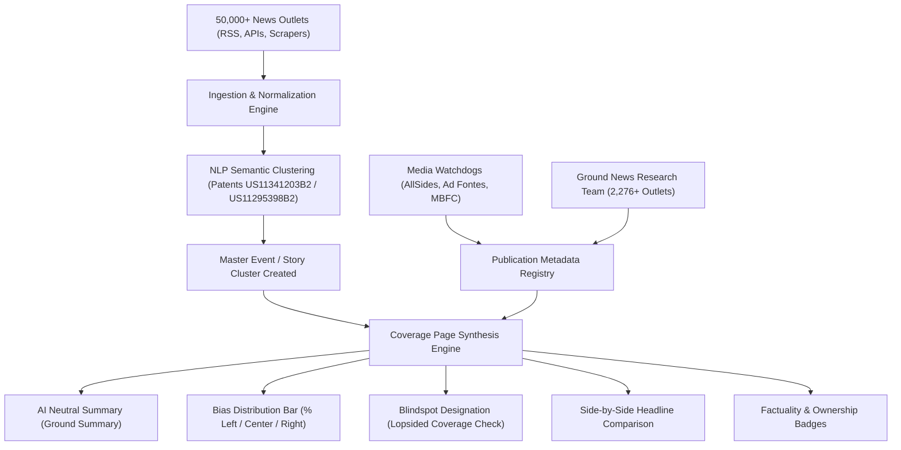
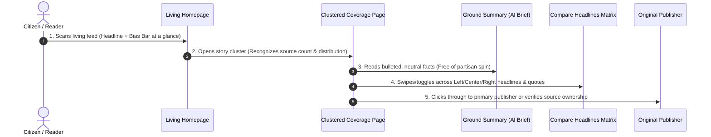
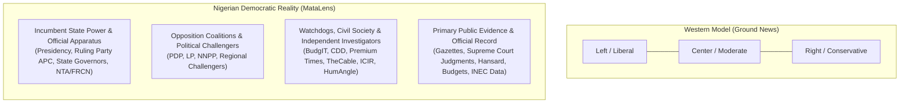
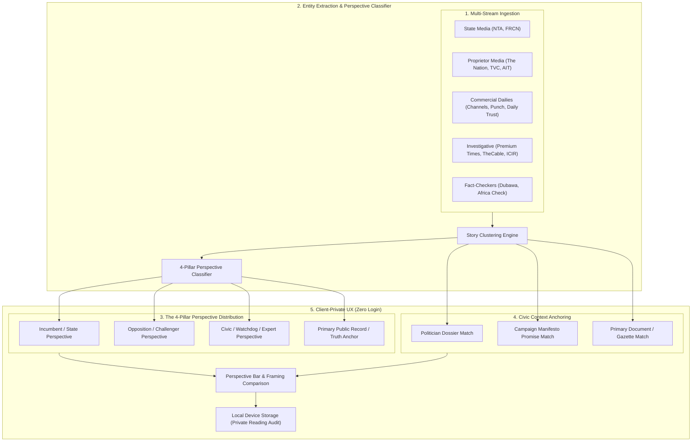
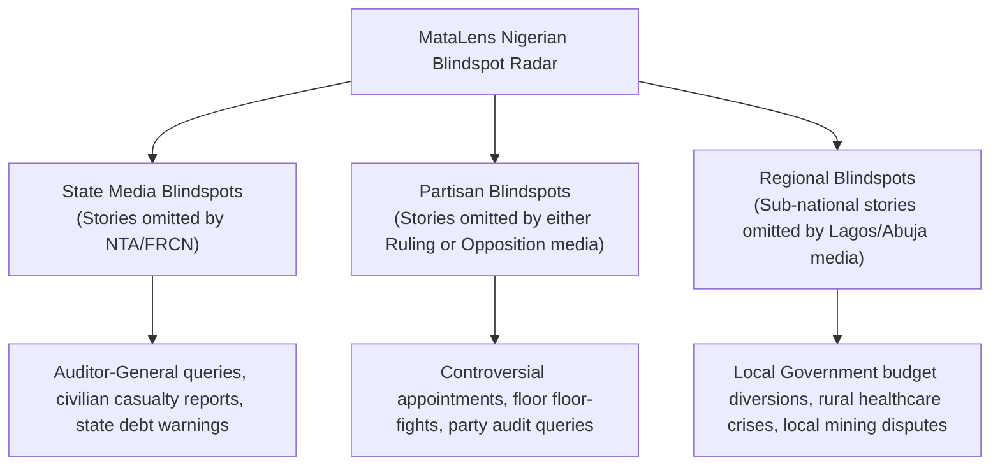

# Ground News Research & Perspective Engine Architecture for MataLens

> **Mission:** Investigate the underlying product architecture, clustering mechanics, transparency indicators, and reading journey of **Ground News** (operated by Snapwise Inc.) and formulate an impartial, nonpartisan **"Development & Perspective" Engine** for the **MataLens** civic platform pivot.
>
> **Core Civic Pivot:** MataLens is pivoting to a personal, nonpartisan political-learning companion for Nigerians. This research establishes how to adapt multi-source comparison, bias detection, and publisher transparency to the distinct realities of Nigerian democratic life—replacing Western "Left vs. Right" ideological models with an authentic Nigerian multi-perspective framework grounded in primary public documents, election manifestos, verified fact-checking, and client-private zero-login architecture.

---

## Table of Contents
1. [Executive Summary: The Nonpartisan Civic News Challenge](#1-executive-summary-the-nonpartisan-civic-news-challenge)
2. [Ground News Architectural & Feature Deconstruction](#2-ground-news-architectural--feature-deconstruction)
   - 2.1 [Multi-Source Story Clustering & Event Grouping](#21-multi-source-story-clustering--event-grouping)
   - 2.2 [Transparency & Credibility Indicators](#22-transparency--credibility-indicators)
     - 2.2.1 [The Bias Distribution Bar](#221-the-bias-distribution-bar)
     - 2.2.2 [Factuality Scoring](#222-factuality-scoring)
     - 2.2.3 [Media Ownership Transparency](#223-media-ownership-transparency)
     - 2.2.4 [The Blindspot Detection Engine](#224-the-blindspot-detection-engine)
     - 2.2.5 [Provenance ("Broke the News") & Geographic Spread](#225-provenance-broke-the-news--geographic-spread)
   - 2.3 [The 5-Stage Reading Journey](#23-the-5-stage-reading-journey)
   - 2.4 [The Follow / Personalization Model & Paywall Analysis](#24-the-follow--personalization-model--paywall-analysis)
3. [The Nigerian Information Space & Why Western "Left vs. Right" Collapses](#3-the-nigerian-information-space--why-western-left-vs-right-collapses)
   - 3.1 [The Ideological Mismatch: Coalitions & Cross-Carpeting](#31-the-ideological-mismatch-coalitions--cross-carpeting)
   - 3.2 [The Real Nigerian Media Fault Lines](#32-the-real-nigerian-media-fault-lines)
   - 3.3 [Regional & Geopolitical Dynamics (6 Geopolitical Zones)](#33-regional--geopolitical-dynamics-6-geopolitical-zones)
   - 3.4 [Verification Infrastructure (Dubawa, Africa Check, CDD West Africa)](#34-verification-infrastructure-dubawa-africa-check-cdd-west-africa)
4. [The MataLens Perspective Engine: The Nigerian Adaptation Model](#4-the-matalens-perspective-engine-the-nigerian-adaptation-model)
   - 4.1 [The 4-Pillar Perspective Distribution Framework](#41-the-4-pillar-perspective-distribution-framework)
   - 4.2 [Nigerian Media Directory & Proprietor Transparency Registry](#42-nigerian-media-directory--proprietor-transparency-registry)
   - 4.3 [Sourced Manifesto & Policy Linkage Engine](#43-sourced-manifesto--policy-linkage-engine)
   - 4.4 [Nigerian Blindspot Engine (State, Partisan, and Regional Omissions)](#44-nigerian-blindspot-engine-state-partisan-and-regional-omissions)
5. [Zero-Mandatory-Login, Client-Private Architecture](#5-zero-mandatory-login-client-private-architecture)
   - 5.1 [Guest-First Civic Ethics vs. Commercial Paywall Lock-in](#51-guest-first-civic-ethics-vs-commercial-paywall-lock-in)
   - 5.2 [Local-First Preference Engine (`localStorage` / IndexedDB)](#52-local-first-preference-engine-localstorage--indexeddb)
   - 5.3 [On-Device "Civic Perspective Audit" (Private Reading Balance)](#53-on-device-civic-perspective-audit-private-reading-balance)
   - 5.4 [Bandwidth Optimization & Offline Reading for Low-Connectivity Networks](#54-bandwidth-optimization--offline-reading-for-low-connectivity-networks)
6. [Component Anatomy & Production UI/UX Blueprints](#6-component-anatomy--production-uiux-blueprints)
   - 6.1 [Living Perspective Feed Card](#61-living-perspective-feed-card)
   - 6.2 [Clustered Event / Coverage Header & Perspective Bar](#62-clustered-event--coverage-header--perspective-bar)
   - 6.3 [Neutral Synthesized Event Summary (MataLens Civic Brief)](#63-neutral-synthesized-event-summary-matalens-civic-brief)
   - 6.4 [Framing Comparison Slider & Perspective Cards](#64-framing-comparison-slider--perspective-cards)
   - 6.5 [Manifesto & Primary Document Truth Anchor Drawer](#65-manifesto--primary-document-truth-anchor-drawer)
   - 6.6 [Blindspot Radar Card](#66-blindspot-radar-card)
7. [Technical Data Models & TypeScript Specifications](#7-technical-data-models--typescript-specifications)
8. [Implementation Roadmap & Neutrality Guardrails for MataLens Engineers](#8-implementation-roadmap--neutrality-guardrails-for-matalens-engineers)

---

## 1. Executive Summary: The Nonpartisan Civic News Challenge

Modern civic news consumption is profoundly broken by two divergent failures:
1. **The Partisan Echo Chamber:** Algorithmic feeds optimize for rage and tribal validation, sorting citizens into information silos where they consume selective facts and distorted framing.
2. **The Passive Fact-Checking Silo:** Traditional fact-checkers debunk specific claims days after they go viral, but rarely provide citizens with an ongoing, intuitive mechanism to compare real-time coverage, understand media ownership motives, or anchor breaking headlines to official policy commitments and constitutional documents.

**Ground News** (founded by former NASA engineer Harleen Kaur and operated by Snapwise Inc.) pioneered an exceptionally effective commercial solution for Western media: instead of publishing news, it aggregates articles from 50,000+ sources, clusters them around real-world events, and visually maps each story’s coverage across political bias, factuality, and corporate ownership.

However, a direct clone of Ground News would fail catastrophically in Nigeria:
- **The Western "Left vs. Right" ideological spectrum is structurally irrelevant in Nigeria.** Nigerian political competition does not divide into social liberalism vs. fiscal conservatism; it divides along **incumbent state power, regional/geopolitical coalitions, political godfather/proprietor patronage, and civic accountability**.
- **Ground News gates essential credibility data behind commercial paywalls.** Factuality scores and ownership tracking are locked behind \$9.99/yr to \$29.99/yr subscriptions (Vantage tier), while personalized tracking requires account creation. In a developing democracy with high smartphone penetration but low disposable income for news subscriptions, locking transparency behind a paywall disenfranchises the very citizens who need it most.
- **Ground News stops at the news article.** It compares what publishers say, but rarely links claims back to **official campaign manifestos, gazetted statutes, legislative votes, or auditor-general audits**.

**The MataLens Pivot:** MataLens will build an original, guest-first **"Development & Perspective Engine"** inspired by Ground News's clustering and transparency elegance, but engineered specifically for Nigerian democracy:
1. Replacing "Left/Center/Right" with the **4-Pillar MataLens Perspective Framework**: `[ Incumbent/State | Opposition/Challenger | Watchdog/Civic | Primary Public Record ]`.
2. Offering **100% free, un-paywalled credibility indicators**, source ownership records, and verified IFCN fact-check links.
3. Anchoring political news directly to **Politician Dossiers, Documented Campaign Manifestos, and Primary Public Evidence**.
4. Implementing a **guest-first, zero-mandatory-login architecture** where all following, bookmarks, and personal reading audits remain strictly on the citizen's device.

---

## 2. Ground News Architectural & Feature Deconstruction

Ground News functions as an analytical layer over the global news ecosystem. It does not employ a traditional reporting newsroom; rather, it uses automated natural language processing (NLP), clustering algorithms, and third-party media watchdog ratings to deconstruct coverage.



### 2.1 Multi-Source Story Clustering & Event Grouping
Snapwise Inc. holds key patents (*US Patent No. US11341203B2* and *US11295398B2*: *"Methods and systems to generate information about news source items describing news events or topics of interest"*). The system solves the "many-to-one" problem in digital journalism:
1. **Entity & Event Extraction:** Articles are ingested continuously. Named entity recognition (NER) identifies individuals, government agencies, locations, and temporal markers.
2. **Semantic Similarity & Time Windows:** Machine learning models measure vector embeddings of headline and lead paragraph text within rolling time windows (typically 24 to 72 hours). Articles exceeding a cosine similarity threshold are assigned to an ephemeral event cluster.
3. **Master Event Generation:** When multiple distinct news outlets report on the same event, the platform synthesizes an overarching neutral event title (e.g., *"Gazans return to battered camp after Israel says it concluded tank raid"*), while preserving every individual publisher's original headline, timestamp, and URL.
4. **Human-in-the-Loop Reclassification:** Ground News employs editorial staff to correct algorithmic clustering errors, split merged stories, or reassign stray articles.

### 2.2 Transparency & Credibility Indicators

#### 2.2.1 The Bias Distribution Bar
Ground News's signature visual element is the **Bias Bar**. Rather than rating a story itself as biased, it measures the **aggregate political leaning of the publications covering that story**.

```
[ Left: 50% (4 sources) | Center: 38% (3 sources) | Right: 12% (1 source) ]
```

- **Scale:** 7 ratings—*Far Left, Left, Lean Left, Center, Lean Right, Right, Far Right*.
- **Data Provenance:** Aggregated average of three independent American watchdog organizations:
  1. **AllSides:** Editorial reviews, blind bias surveys, community reviews across 16 bias types (spin, sensationalism, slant, omission).
  2. **Ad Fontes Media:** Methodological content analysis behind the famous Media Bias Chart.
  3. **Media Bias/Fact Check (MBFC):** Quantitative evaluation of editorial positions and historical track record.
- **Critical Distinction:** Ratings apply strictly at the **publication level**, not to individual journalists or individual articles.
- **Color Coding:** Configurable by region (e.g., Blue-Left / Red-Right for US politics, or Red-Left / Blue-Right for Commonwealth/UK/India contexts).

#### 2.2.2 Factuality Scoring
The **Factuality Score** assesses an outlet's journalistic rigor:
- **Scale:** *Very Low, Low, Mixed, High, Very High*.
- **Criteria:** History of passing/failing fact-checks, reliance on named vs. anonymous sources, transparency in corrections and retractions, use of original reporting vs. clickbait re-writing.
- **Partner Inputs:** Derived from Ad Fontes Media reliability ratings and Media Bias Fact Check credibility scores.

#### 2.2.3 Media Ownership Transparency
Ground News hand-researched and categorized ownership for 2,276+ news organizations into 8 discrete categories:
1. **Media Conglomerates:** Large corporate entities owning dozens of print, TV, and radio properties (e.g., Gannett, News Corp, Paramount).
2. **Private Equity:** Investment funds that purchased outlets via leveraged buyouts; notorious for aggressive cost-cutting and newsroom layoffs.
3. **Individual:** Ultra-high-net-worth individuals who made their fortunes outside journalism and bought media assets (e.g., Jeff Bezos owning *The Washington Post*, Patrick Soon-Shiong owning *The Los Angeles Times*).
4. **Government:** State-funded or state-operated broadcasting and news services (e.g., BBC, PBS, CBC, CGTN, RT).
5. **Telecom:** Connectivity and telecom providers that vertically integrated into content production (e.g., Comcast/NBCUniversal).
6. **Corporation:** Commercial enterprises whose primary business is outside news (e.g., Alibaba owning *South China Morning Post*).
7. **Independent:** Outlets free from government, conglomerate, or corporate control; any ownership stake > 5% is treated as having material influence.
8. **Other:** Non-profits, cooperatives, and unclassified regional entities.

#### 2.2.4 The Blindspot Detection Engine
A **Blindspot** occurs when a news story with political significance is **disproportionately covered by one side of the political spectrum while being largely ignored by the other**:
- **Left Blindspot:** A story heavily covered by Right-leaning and Center media (e.g., > 60-70% Right/Center coverage), but covered by < 15-20% of Left-leaning sources. Readers in Left-leaning bubbles are "blind" to this story.
- **Right Blindspot:** A story heavily covered by Left-leaning and Center media, but omitted by Right-leaning outlets.
- **UX Role:** Ground News presents a dedicated **"Blindspot Feed"** where users can filter by *"For the Left"* (stories progressives are missing) and *"For the Right"* (stories conservatives are missing). This creates **constructive cognitive friction**, urging users to ask: *"Why is my preferred news source refusing to cover this?"*

#### 2.2.5 Provenance ("Broke the News") & Geographic Spread
On every coverage page, Ground News surfaces:
- **First Mover Attribution:** *"Le Devoir broke the news in Montreal, Canada, 16 hours ago."* This establishes who initiated the reporting vs. who merely syndicated or re-packaged it.
- **Geographic Origin:** E.g., *"Sources are mostly out of the United States (65%) and United Kingdom (20%)."* This reveals whether an international conflict or economic event is being framed purely by Western wire services or local regional reporting.

---

### 2.3 The 5-Stage Reading Journey

Ground News structures the reader's journey to combat information overwhelm:



1. **Stage 1: Scanning the Living Homepage**
   - The user browses a dynamic feed. Each card displays an event title, publication timestamp, source count (e.g., "34 sources"), and the miniaturized **Bias Bar** (showing the visual ratio of blue, gray, and red).
   - The user immediately perceives whether an issue is broadly accepted or a partisan wedge topic before clicking.

2. **Stage 2: Opening the Clustered Coverage Page**
   - The page opens with the unified event title, followed immediately by the **Coverage Details Dashboard**: total source count, breakdown percentages, bias distribution bar, factuality rating badge, and "Broke the news" provenance.

3. **Stage 3: Reading the Neutral Synthesized Summary ("Ground Summary")**
   - Before exposing the reader to partisan commentary, Ground News presents a 2-3 bullet point summary synthesizing the **consensus factual baseline** agreed upon by all reporting outlets.
   - Example: *"What happened: The government announced a 15% tariff reduction on imported agricultural machinery. Effective date is December 1. Implementation guidelines will be published by the Ministry of Finance."*

4. **Stage 4: Comparing Multiple Publisher Perspectives ("Compare Headlines")**
   - The user reaches the comparative framing section. Headlines and lead snippets are grouped in three horizontal columns or swipeable tabs (*Left*, *Center*, *Right*).
   - The reader observes how language choices diverge:
     - Left headline: *"Government cuts tariffs, risking local manufacturing jobs."*
     - Center headline: *"Tariff reduction on agricultural machinery enacted for Q4."*
     - Right headline: *"Long-overdue deregulation eases cost burdens on commercial farming."*

5. **Stage 5: Inspecting Source Metadata & Primary Links**
   - The reader can open any individual source card to inspect the publisher’s country of origin, ownership category (e.g., Private Equity), and factuality rating.
   - A direct outbound link (*"Read Full Article"*) opens the publisher’s original page.

---

### 2.4 The Follow / Personalization Model & Paywall Analysis

Ground News implements a commercial freemium funnel:
- **Free Tier:** Access to top stories, basic bias distribution percentages, limited blindspot feed, and headline comparison.
- **Pro Tier (\$9.99/year):** Unlocks full Blindspot Feed, unlimited topic and location following, bias audit history, and advanced filters.
- **Vantage Tier (\$29.99/year):** Unlocks Factuality Scores, Media Ownership breakdowns, detailed source audits, and international editions.
- **Account Requirement:** Personalization ("For You" feed, topic follows, custom sources) requires a mandatory registered account (Google, Apple, or email sign-up).
- **Critical Assessment for MataLens:** While effective for a North American commercial subscription business, this model is **unacceptable for MataLens**:
  - A civic platform for democracy cannot withhold factuality and media ownership transparency behind a paywall.
  - Mandatory sign-in creates an insurmountable barrier for privacy-conscious citizens and violates the project's non-negotiable rule: **"MataLens is guest-first and has NO mandatory sign-in."**

---

## 3. The Nigerian Information Space & Why Western "Left vs. Right" Collapses

Attempting to import a Western liberal-versus-conservative taxonomy into Nigerian news analysis is an analytical category error.



### 3.1 The Ideological Mismatch: Coalitions & Cross-Carpeting
In Western democracies, parties align roughly with consistent political philosophies regarding the role of government, taxation, social welfare, and individual liberties.

In Nigeria:
- Major political parties—the **All Progressives Congress (APC)**, **Peoples Democratic Party (PDP)**, **Labour Party (LP)**, and **New Nigeria Peoples Party (NNPP)**—are primarily **national elite coalitions and regional alliances**, not rigid ideological movements.
- **Cross-carpeting (defection between parties) is routine:** Politicians frequently switch from the ruling party to the opposition and back within single electoral cycles, bringing their networks and patronage with them.
- Consequently, labeling a Nigerian news article "Left-wing" or "Right-wing" is nonsensical to a Nigerian reader. A newspaper is not conservative or progressive; it is either **aligned with the government in power, loyal to a specific political proprietor/patron, or operating as an independent public-interest watchdog**.

### 3.2 The Real Nigerian Media Fault Lines

An empirical audit of the Nigerian news ecosystem reveals four dominant operational tiers:

| Media Category | Prominent Examples | Ownership & Governance Structure | Typical Editorial Bias & Framing Tendency |
| :--- | :--- | :--- | :--- |
| **State / Public Apparatus** | Nigerian Television Authority (NTA), Federal Radio Corporation of Nigeria (FRCN / Radio Nigeria), News Agency of Nigeria (NAN), State-owned TV/Radio (LTV, OGTV, etc.) | Federal and State Government owned; executives appointed by executive branch. | **Pro-incumbent, state-sanctioned messaging.** Uncritical reporting of government achievements; omission of state security failures, strikes, and corruption allegations. |
| **Proprietor / Patronage Commercial Press** | *The Nation*, *TVC News* (Continental Broadcasting Service), *African Independent Television (AIT)* / *RayPower*, *Daily Sun*, *Leadership* | Owned by prominent political figures, former governors, senators, or party godfathers. | **Patron-aligned framing.** Editorial line actively protects owner's political allies and attacks partisan rivals. *The Nation* and *TVC* historically reflect progressive/APC lineage; *AIT* historically reflected late Raymond Dokpesi/PDP lineage; *Daily Sun* historically reflects Orji Uzor Kalu lineage. |
| **Independent Commercial Mainstream** | *Channels Television*, *The Punch*, *Daily Trust*, *Vanguard*, *The Guardian*, *ThisDay*, *Arise News* | Legacy commercial private enterprises funded by advertising and circulation; professional editorial boards. | **Mainstream commercial / investigative.** Generally balanced on national issues, but subject to commercial advertiser pressures and regional readership sympathies (*Daily Trust* northern perspective; *Punch* / *Guardian* southwestern civic tradition; *Vanguard* southern/oil-belt focus). |
| **Digital Accountability & Investigative Outlets** | *Premium Times*, *TheCable*, *International Centre for Investigative Reporting (ICIR)*, *HumAngle*, *Stears*, *Foundation for Investigative Journalism (FIJ)* | Independent digital-native newsrooms; donor/grant-supported (MacArthur, Luminate, Ford) and subscription-based. Non-profit governance models. | **Watchdog / High-Factuality.** Rigorous investigative standards, deep accountability reporting, extensive use of public records and freedom-of-information (FOI) requests. Willing to indict both ruling and opposition figures. |
| **Hyperpartisan & Viral Channels** | Partisan PR blogs, Nairaland political sections, anonymous X handles, WhatsApp broadcast syndicates | Anonymous, self-funded, or covertly financed by political campaign media cells ("cyber warriors"). | **Extremely Low Factuality / High Sensationalism.** Unverified leaks, deepfakes, ethnic dog-whistles, targeted smear campaigns, manufactured endorsements. |

### 3.3 Regional & Geopolitical Dynamics (6 Geopolitical Zones)
Nigeria's political geography is structured across six constitutionally recognized geopolitical zones:
1. **North-West (NW):** Kano, Kaduna, Katsina, Sokoto, Kebbi, Zamfara, Jigawa
2. **North-East (NE):** Borno, Yobe, Adamawa, Bauchi, Gombe, Taraba
3. **North-Central / Middle Belt (NC):** Plateau, Benue, Nasarawa, Niger, Kwara, Kogi, FCT Abuja
4. **South-West (SW):** Lagos, Oyo, Ogun, Ondo, Osun, Ekiti
5. **South-East (SE):** Anambra, Imo, Enugu, Abia, Ebonyi
6. **South-South / Niger Delta (SS):** Rivers, Delta, Akwa Ibom, Bayelsa, Cross River, Edo

**The National Media Hegemony Problem:**
Over 75% of Nigeria’s national print and broadcast media headquarters are concentrated in **Lagos and Abuja**. This produces severe regional blindspots:
- Violence, climate displacement, or local government accountability crises in the North-East, Middle Belt, or Niger Delta are routinely ignored by the Lagos press until they reach catastrophic proportions.
- Local community governance and state assembly legislative actions in sub-national states operate virtually without scrutiny from national television networks.

### 3.4 Verification Infrastructure (Dubawa, Africa Check, CDD West Africa)
Nigeria possesses one of Africa's most robust independent fact-checking ecosystems:
- **Dubawa:** Founded by the Centre for Journalism Innovation and Development (CJID; formerly PTCIJ). Signatory to the International Fact-Checking Network (IFCN). Publishes structured fact-checks with verdicts: *True, Mostly True, False, Misleading, Unproven*.
- **Africa Check (Nigeria Office):** The continent’s pioneer IFCN signatory fact-checking organization. Specializes in statistical data, budget claims, and macroeconomic assertions.
- **Centre for Democracy and Development (CDD West Africa):** Operates election analysis and disinformation war-rooms during Nigerian electoral cycles.
- **The Nigerian Fact-Checkers Coalition (NFC):** A collaborative alliance between Dubawa, Africa Check, ICIR, FactCheckHub, and mainstream newsrooms (Channels TV, The PUNCH, TheCable) to live-verify presidential debates and election-day result declarations.

**MataLens Strategic Advantage:**
Rather than paying third-party American vendors (AllSides, Ad Fontes) who possess zero ratings for Nigerian media, MataLens can partner with or reference publicly available data from **IFCN-certified Nigerian fact-checkers** and establish a publicly documented, transparent Nigerian media directory.

---

## 4. The MataLens Perspective Engine: The Nigerian Adaptation Model

Based on our empirical analysis of Ground News and Nigerian media dynamics, MataLens will implement the **"Development & Perspective Engine"**.



### 4.1 The 4-Pillar Perspective Distribution Framework

Instead of the Western Left/Center/Right bar, MataLens stories feature the **MataLens Perspective Bar**:

```
[ Incumbent: 35% | Opposition: 25% | Watchdog: 25% | Primary Record: 15% ]
```

Each pillar represents a verifiable institutional vantage point:

1. **Incumbent / Official Administration (Color: Forest Green `#0A4D34`)**
   - Statements, policies, press briefings, and defenses from the Presidency, Federal Ministries, State Governors, Commissioners, law enforcement leadership, and ruling-party spokespersons.
   - Purpose: Documents the government's official rationale and claims of progress.
2. **Opposition / Political Challengers (Color: Deep Amber/Ochre `#C25E00`)**
   - Counter-statements, critiques, policy alternatives, and scrutiny from opposition party leadership (PDP, LP, NNPP, APGA), shadow committees, and political challengers.
   - Purpose: Documents alternative political proposals and electoral friction.
3. **Civic / Watchdog / Expert Analysis (Color: Royal Teal `#0284C7`)**
   - Independent scrutiny from civil society organizations (BudgIT, SERAP, CDD West Africa, Yiaga Africa), academic economists, legal scholars, and verified investigative journalists (Premium Times, ICIR, HumAngle).
   - Purpose: Provides technical evaluation, empirical data, and public-interest impact assessments.
4. **Primary Public Record / Truth Anchor (Color: Rich Navy `#1E3A8A`)**
   - Verifiable constitutional, statutory, and official primary documents: Acts of the National Assembly, Supreme Court or Court of Appeal judgments, Federal Republic of Nigeria Official Gazettes, BudgIT open treasury figures, or official INEC gazetted returns.
   - Purpose: Elevates the discussion from subjective rhetoric to verifiable legal and historical fact.

### 4.2 Nigerian Media Directory & Proprietor Transparency Registry

MataLens will maintain an open-source, hand-researched, and continuously updated directory of Nigerian media outlets (stored in `data/publishers.json`). Each publisher card will transparently disclose:
- **Publisher Name & Logo:** E.g., *The Nation*.
- **Ownership Classification:** *Proprietor / Politically Aligned* (Disclosed affiliation: Linked to APC / President Bola Ahmed Tinubu lineage).
- **Year Founded & Headquarters:** E.g., 2006, Lagos, Nigeria.
- **Editorial Factuality Rating:** *High*, *Mixed*, or *Low* (Based on historical corrections, named sources, and IFCN coalition records).
- **Primary Geopolitical Focus:** National, South-West, Northern Nigeria, Niger Delta, etc.
- **Funding Model:** Commercial advertising, Government subvention, or Non-profit donor funding.

*Zero Paywall Rule:* Every piece of publisher transparency metadata is 100% free and visible to all citizens on every story card.

### 4.3 Sourced Manifesto & Policy Linkage Engine

The single most transformative innovation MataLens introduces over Ground News is the **Civic Truth Anchor**: linking breaking political news directly to **documented election manifestos and official campaign promises**.

When a news cluster involves a major policy topic—such as fuel subsidy removal, local government financial autonomy, state police creation, university tuition loans, or power grid decentralization—the MataLens engine matches the cluster to the verbatim promise made in official campaign documents:
- **Documented Manifestos in Database:**
  - *Renewed Hope 2023* (Asiwaju Bola Ahmed Tinubu & Kashim Shettima / APC)
  - *Our Pact with Nigerians / PO-Datti 2023* (Peter Obi & Datti Baba-Ahmed / LP)
  - *My Covenant with Nigerians 2023* (Atiku Abubakar & Ifeanyi Okowa / PDP)
  - *The RMK Manifesto 2023* (Rabiu Musa Kwankwaso & Isaac Idahosa / NNPP)
  - Selected Sub-National Gubernatorial Manifestos (Lagos, Kano, Rivers, Kaduna, Edo, Ondo).

**The UI Experience:**
Above the news headlines, the story page displays an interactive **"Policy Reference Anchor"**:
> **Manifesto Reference: Renewed Hope (APC 2023), Section 4.2 (National Energy Security):**  
> *"Pledge: We shall complete the privatization of transmission networks and enforce cost-reflective tariffs while guaranteeing a minimum of 18 hours daily supply to industrial hubs."*  
> [View Verbatim PDF Page 44](file:///docs/manifestos/renewed-hope.pdf#page=44) • *Status: Under Active Implementation*

This elevates MataLens from a mere aggregator to a **civic accountability instrument**. Citizens don't just see politicians arguing about tariffs; they see the exact contract the politician asked the country to sign during the election.

### 4.4 Nigerian Blindspot Engine (State, Partisan, and Regional Omissions)

Ground News detects Left vs. Right blindspots. MataLens detects three distinct forms of civic blindspots:



1. **State Media Blindspot:** A critical governance or economic issue receiving extensive coverage from independent investigative outlets and civil society (e.g., *Premium Times*, *BudgIT*, *Punch*), but completely omitted from state-owned television (NTA) and radio networks (FRCN).
   - *Citizen Value:* Alerts citizens when official state broadcasts are whitewashing public crises.
2. **Partisan Blindspot:** A development covered extensively by opposition-leaning or independent media, but completely omitted by proprietor-aligned ruling-coalition outlets (or vice-versa).
3. **Regional Blindspot:** A major grassroots governance or environmental issue with heavy sub-national reporting in local newspapers (e.g., in the North-East, Niger Delta, or South-East), but receiving zero airtime on national primetime television news in Lagos or Abuja.
   - *Citizen Value:* Breaks the metropolitan bubble and forces national attention on neglected sub-national citizens.

---

## 5. Zero-Mandatory-Login, Client-Private Architecture

MataLens is bound by the non-negotiable rule set in `AGENTS.md`:
> *"MataLens is guest-first and has NO mandatory sign-in. Users must be able to open the web app and immediately browse civic guides, election dates, sourced candidate profiles, polling-unit guidance, updates and practice exercises. They must be able to use local bookmarks, reminders and preparation notes without creating an account..."*

### 5.1 Guest-First Civic Ethics vs. Commercial Paywall Lock-in
Commercial platforms use accounts to harvest behavioral data, construct ad-targeting profiles, and build subscription paywalls.

In a democracy:
- Citizens often fear surveillance or political victimization if their reading history or political affiliations are logged on centralized servers.
- Forcing a citizen in an off-grid or rural community to remember a password, enter an email, or confirm an SMS OTP immediately repels them.
- **MataLens Architecture:** 100% of the platform's intelligence, search, filtering, and comparison features operate immediately upon arrival.

### 5.2 Local-First Preference Engine (`localStorage` / IndexedDB)

All stateful user preferences are persisted strictly inside the citizen's browser using `localStorage` and `IndexedDB`:
- **Followed Politician Dossiers:** `matalens_followed_politicians` (List of politician IDs).
- **Followed Geographic Constituencies:** `matalens_user_constituencies` (State, Senatorial District, Federal Constituency, LGA, Ward).
- **Followed Policy Topics:** `matalens_followed_topics` (e.g., `"energy"`, `"electoral-reform"`, `"education"`, `"security"`).
- **Saved Story Clusters & Primary Records:** `matalens_saved_evidence` (Bookmarks with encrypted/private offline snapshots).
- **Private Preparation Notes:** Kept entirely in client storage; never synchronized to a server.

### 5.3 On-Device "Civic Perspective Audit" (Private Reading Balance)

Ground News offers a popular feature where it audits a user's reading history and tells them their bias score (e.g., *"You read 60% Left, 30% Center, 10% Right"*). However, Ground News stores this data on its servers.

**MataLens achieves the same capability with total privacy through an on-device audit:**
1. When a user reads a story cluster, the MataLens client updates a local lightweight counter in `localStorage`:
   ```json
   {
     "readClusters": 18,
     "perspectiveTally": {
       "incumbent": 42,
       "opposition": 18,
       "watchdog": 28,
       "primaryRecord": 12
     },
     "lastAuditDate": "2026-11-20T10:00:00Z"
   }
   ```
2. The user can open their private **"My Civic Perspective"** tab at any time:
   - Visualizes their reading balance over the last 7, 30, or 90 days.
   - Gently highlights personal blindspots:  
     *"Your reading this month has drawn heavily from official government briefings (62%). You may be missing independent civil society investigations on the national debt and state assembly votes. Explore these 3 Watchdog Blindspots."*
3. **Zero Telemetry Guarantee:** No HTTP request ever leaves the device containing the user's reading history, perspective tally, or followed candidates.

### 5.4 Bandwidth Optimization & Offline Reading for Low-Connectivity Networks
In Nigeria, mobile data is expensive, and 3G/4G connectivity is frequently unstable. MataLens incorporates:
- **Ultra-lightweight Payload:** Event clusters are pre-rendered as static HTML and cached via service workers (PWA).
- **Text-First Fallback:** News summaries and perspective comparisons consume < 25KB of gzipped JSON per story, allowing instantaneous rendering even in 2G Edge conditions.
- **Offline Save:** A single tap on any cluster saves the full neutral summary, manifesto reference, and offline comparison to the device’s IndexedDB storage.

---

## 6. Component Anatomy & Production UI/UX Blueprints

Following the MataLens unified design language (Forest Green `#0A4D34`, Sand `#F9FAF6`, restrained gloss, and 4px spatial grid), here are the concrete UI/UX component blueprints.

### 6.1 Living Perspective Feed Card

The primary card displayed on the MataLens homepage feed.

```
+-----------------------------------------------------------------------+
|  TOPIC: ENERGY POLICY • 2 HOURS AGO • 14 SOURCES                      |
|                                                                       |
|  Federal Government Approves Direct Electricity Distribution to       |
|  Industrial Parks; NERC Issues Revised Tariff Framework               |
|                                                                       |
|  [ PERSPECTIVE DISTRIBUTION BAR ]                                     |
|  +--------------------+---------------+---------------+---------------+
|  | Incumbent 40%      | Oppos. 20%    | Watchdog 25%  | Record 15%    |
|  +--------------------+---------------+---------------+---------------+
|                                                                       |
|  • Provenance: Daily Trust broke 4h ago in Abuja                      |
|  • Sourced Manifesto Anchor: Renewed Hope 2023, Section 4.2           |
|  • Primary Document: NERC Order 2026/04 Attached                      |
|                                                                       |
|  [ Read Neutral Summary ]    [ Compare 4 Angles ]     [ Save Bookmark]|
+-----------------------------------------------------------------------+
```

### 6.2 Clustered Event / Coverage Header & Perspective Bar

At the top of the event coverage page:
- **Title:** The editorialized, consensus event headline.
- **Metadata Badges:**
  - `14 Total News Sources`
  - `Broke by Premium Times in Abuja • Nov 19, 2026`
  - `Dubawa Fact-Check Attached`
- **Interactive Perspective Bar:**
  - Interactive segmented progress bar. Hovering or tapping each segment reveals the number of sources representing that institutional perspective.

### 6.3 Neutral Synthesized Event Summary (MataLens Civic Brief)

A dedicated, high-character reading surface:
- Uses `Newsreader` editorial serif (18px/1.65 measure).
- Contains three distinct subsections:
  1. **The Core Development (What Occurred):** 2 concise sentences describing the concrete real-world occurrence, verified date, and official actors.
  2. **The Stated Rationale (Why Officials Say It Happened):** Unvarnished presentation of the government's official objectives or legal justification.
  3. **The Material Impact (Who Is Affected):** Concrete details on economic costs, geographic jurisdiction, effective dates, and which citizens are impacted.

### 6.4 Framing Comparison Slider & Perspective Cards

Below the neutral summary, an interactive multi-column carousel allows citizens to compare headlines and editorial framing side-by-side:

```
+-----------------------+-----------------------+-----------------------+
| INCUMBENT PERSPECTIVE | OPPOSITION CRITIQUE   | WATCHDOG ANALYSIS     |
+-----------------------+-----------------------+-----------------------+
| THE NATION (Proprietor)| VANGUARD (Mainstream) | THECABLE (Investig.)  |
| Factuality: High      | Factuality: High      | Factuality: Very High |
|                       |                       |                       |
| "New Electricity Rule | "Opposition Slams New | "NERC's New Order:    |
| to Unlock 24-Hour     | Industrial Tariffs as | What It Means for     |
| Power for Industry"   | Burden on Struggling  | Factory Workers and   |
|                       | Manufacturers"        | Small Businesses"     |
|                       |                       |                       |
| Excerpt: "The Federal | Excerpt: "Labour Party| Excerpt: "Independent |
| Government has taken a| economic caucus warned| analysis of the NERC  |
| decisive step toward  | that the tariff hike  | gazette indicates a   |
| industrialization by  | will trigger factory  | 35% cost surge for tier|
| allowing direct sales | closures across the   | 2 consumers without   |
| from GenCos..."       | southern belt..."     | guaranteed supply..." |
|                       |                       |                       |
| [ Read Full Article ] | [ Read Full Article ] | [ Read Full Article ] |
+-----------------------+-----------------------+-----------------------+
```

### 6.5 Manifesto & Primary Document Truth Anchor Drawer

Accessible directly from the story card:
- **Manifesto Pledge Card:**
  - Displays party logo, candidate portrait, exact manifesto title, chapter, and page number.
  - Verbatim excerpt of the original campaign promise.
  - Objective implementation status badge: `Not Started`, `In Progress`, `Partially Realized`, `Contradicted by Legislation`.
- **Primary Document Viewer:**
  - Embedded viewer or link to the official gazette, court judgment, or National Assembly bill tracker.

### 6.6 Blindspot Radar Card

Surfaced on the homepage feed and within the dedicated Blindspot tab:
- **Card Header:** *"State Media Blindspot detected in Governance"*
- **Headline:** *"Auditor-General's 2025 Audit Highlights \$140M Unaccounted Crude Oil Revenue"*
- **Omission Indicator:**
  - `Covered by: 9 Independent & Commercial Sources (Premium Times, Channels TV, Punch, Daily Trust)`
  - `Omitted by: NTA, FRCN, Radio Nigeria, State TV Networks (0 Broadcast Mentions)`
- **Action:** *"See what state broadcasts didn't report"*

---

## 7. Technical Data Models & TypeScript Specifications

The following TypeScript definitions form the foundational domain schema for the MataLens Development & Perspective Engine:

```typescript
// types/perspective-engine.ts

/**
 * The 4 institutional perspectives in Nigerian civic news
 */
export type PerspectiveType = 
  | 'incumbent'     // Official Government / Ruling Party administration
  | 'opposition'    // Political challengers & opposition parties
  | 'watchdog'      // Civil society, investigative journalists, independent experts
  | 'primary_record'; // Official gazettes, court rulings, statutory audits

/**
 * Classification of Nigerian media ownership
 */
export type OwnershipCategory =
  | 'state_federal'     // Federal government owned (NTA, FRCN, NAN)
  | 'state_regional'    // Sub-national state government owned (LTV, OGTV, etc.)
  | 'proprietor_aligned'// Owned by politician, former governor, or party patron
  | 'commercial_private'// Independent commercial mainstream enterprise
  | 'investigative_ngo' // Non-profit / Donor-supported investigative newsroom
  | 'hyperpartisan_blog';// Anonymous or political-action PR blog

/**
 * Journalistic factuality rating grounded in IFCN and verification track record
 */
export type FactualityLevel = 
  | 'very_high' // Rarely fails fact-checks; primary FOI investigations; rapid corrections
  | 'high'      // Sourced mainstream reporting; clear corrections policy
  | 'mixed'     // Blend of reporting and unverified opinion/press releases
  | 'low'       // Frequent unverified viral claims; poor correction transparency
  | 'unrated';

/**
 * Nigerian Geopolitical Zones
 */
export type GeopoliticalZone = 
  | 'north_west'
  | 'north_east'
  | 'north_central'
  | 'south_west'
  | 'south_east'
  | 'south_south'
  | 'national';

/**
 * Metadata profile for a Nigerian news publication
 */
export interface PublisherProfile {
  id: string;
  name: string;
  slug: string;
  logoUrl?: string;
  websiteUrl: string;
  headquarters: string; // e.g., "Abuja", "Lagos", "Ibadan", "Kano"
  primaryZone: GeopoliticalZone;
  ownershipType: OwnershipCategory;
  disclosedOwnerOrAffiliation?: string; // e.g., "Linked to APC / Tinubu lineage"
  factualityScore: FactualityLevel;
  ifcnSignatoryOrPartner: boolean; // e.g., Premium Times, Dubawa, Channels
  editorialStanceSummary: string;
}

/**
 * A single news article covering an event
 */
export interface ClusteredArticle {
  id: string;
  publisherId: string;
  publisher: PublisherProfile;
  title: string;
  originalUrl: string;
  publishedAt: string;
  perspective: PerspectiveType;
  framingExcerpt: string; // 1-2 sentence lead illustrating their narrative framing
  author?: string;
  isFirstReport: boolean; // "Broke the news" provenance flag
}

/**
 * Cross-reference to official election manifestos or policy pledges
 */
export interface ManifestoAnchor {
  id: string;
  candidateName: string;
  officeSought: string; // e.g., "President of Nigeria (2023)"
  party: string;        // e.g., "APC", "LP", "PDP", "NNPP"
  manifestoTitle: string; // e.g., "Renewed Hope 2023"
  sectionOrChapter: string;
  pageNumber?: number;
  verbatimPromise: string;
  documentUrl: string;
  status: 'not_started' | 'in_progress' | 'realized' | 'contradicted';
}

/**
 * Primary public document reference (The Truth Anchor)
 */
export interface PrimaryDocumentAnchor {
  id: string;
  title: string; // e.g., "Federal Republic of Nigeria Official Gazette No. 44"
  documentType: 'gazette' | 'court_judgment' | 'nass_act' | 'budget_line' | 'audit_report';
  issuingBody: string; // e.g., "Supreme Court of Nigeria", "Auditor-General"
  referenceNumber?: string;
  gazetteDate: string;
  documentUrl: string;
  keyPassageExcerpt: string;
}

/**
 * The Master Event / Story Cluster
 */
export interface NewsCluster {
  id: string;
  slug: string;
  createdAt: string;
  updatedAt: string;
  
  // Consensus Editorial Synthesis
  consensusHeadline: string;
  leadFactSummary: string; // Bulleted neutral facts
  topicTags: string[];
  
  // Geopolitical & Institutional Scope
  relevantZones: GeopoliticalZone[];
  taggedPoliticianIds: string[]; // Linked to MataLens politician profiles
  
  // Perspective Breakdown
  perspectiveDistribution: {
    incumbentPercent: number;
    oppositionPercent: number;
    watchdogPercent: number;
    primaryRecordPercent: number;
    totalSourcesCount: number;
  };
  
  // Provenance
  firstReportedBy: {
    publisherName: string;
    location: string;
    publishedAt: string;
  };
  
  // Blindspot Classification
  blindspotType?: 'state_media_omission' | 'partisan_omission' | 'regional_omission';
  blindspotDescription?: string;
  
  // Linked Primary Anchors
  manifestoAnchor?: ManifestoAnchor;
  primaryDocument?: PrimaryDocumentAnchor;
  
  // All Clustered Articles
  articles: ClusteredArticle[];
}

/**
 * Client-Side Private Reading Audit (Stored in localStorage)
 */
export interface ClientPrivateCivicAudit {
  totalClustersRead: number;
  lastUpdated: string;
  readPerspectiveCounts: Record<PerspectiveType, number>;
  readZoneCounts: Record<GeopoliticalZone, number>;
  bookmarkedClusterIds: string[];
  followedPoliticianIds: string[];
  followedTopicTags: string[];
}
```

---

## 8. Implementation Roadmap & Neutrality Guardrails for MataLens Engineers

### Phase 1: MVP Directory & Static Seed Clusters (Weeks 1-2)
1. **Publisher Directory Implementation:** Compile a verified, hand-coded directory of 30 top Nigerian news organizations (`data/publishers.json`) detailing ownership, factuality, and geopolitical base.
2. **Curated Seed Clusters:** Build 8 high-fidelity, hand-curated real Nigerian political story clusters illustrating fuel subsidy reforms, electoral court rulings, power sector deregulation, and sub-national state elections.
3. **Responsive UI Implementation:** Implement the `PerspectiveBar`, `CompareFramingCarousel`, and `ManifestoAnchor` components in Next.js/Tailwind using the forest-green and restrained gloss system.

### Phase 2: Ingestion Pipeline & Client-Private State (Weeks 3-4)
1. **RSS / API Ingestion Pipeline:** Create an automated ingestion service fetching feeds from top Nigerian publishers (Channels, Punch, Daily Trust, Premium Times, TheCable, NTA).
2. **Entity & Manifesto Matcher:** Automatically detect mentions of tracked politicians and cross-reference relevant manifesto commitments.
3. **Client-Side Storage Hook:** Implement `useCivicAudit` hook in React that manages bookmarks, followed politicians, and on-device perspective balance calculations in `localStorage`.

### Phase 3: Blindspot Radar & Primary Document Repository (Weeks 5-6)
1. **Blindspot Detection Logic:** Automated calculation identifying stories with high independent/investigative coverage but 0 mentions on state broadcasters.
2. **Primary Document Linkage:** Integrate official Federal Gazettes, National Assembly bill summaries, and BudgIT OpenTreasury links.
3. **PWA Offline Service Worker:** Cache read clusters and politician dossiers for full offline access.

### Strict Neutrality Guardrails (Non-Negotiable)
- **Zero Editorial Endorsements:** MataLens never declares a candidate or policy "good" or "bad". It presents what officials promised, what critics argued, what independent watchdogs uncovered, and what the law says.
- **Mandatory Dated Sourcing:** Every political claim, candidate quotation, or manifesto pledge must cite the publication date, author/issuing authority, and direct URL.
- **No Private Political Data Transmission:** Never transmit a user's reading history, followed candidates, or bookmark data to any analytics or server endpoint. Privacy is absolute.
- **Accurate Provenance:** Clearly differentiate unofficial citizen photo reports from verified publisher news and primary court documents.

---
*Report prepared for the MataLens Engineering Team. Saved to `docs/design-planning/research-ground-news.md`.*
