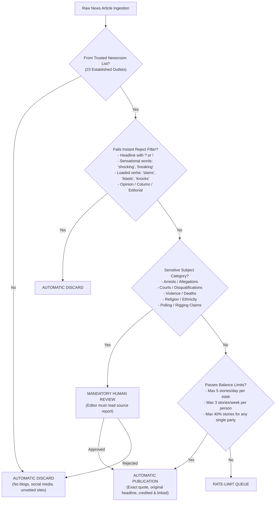
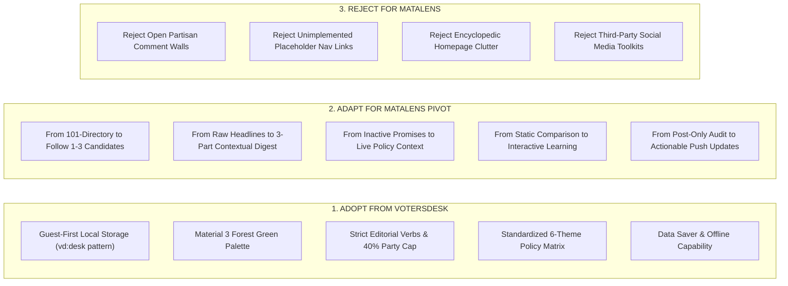

# VotersDesk Reverse Engineering & Research Report
**Investigation Target:** [VotersDesk](https://votersdesk.ng/) (also accessible as `votersdesk.com`)  
**Mission:** Comprehensive architectural, visual, editorial, and workflow audit to guide the MataLens civic platform pivot — transitioning from an election-preparation dashboard to a personal, nonpartisan political-learning companion for Nigerians.  
**Date of Audit:** 20 November 2026  
**Methodology:** Direct inspection of live endpoints, sitemaps, Next.js client bundles, compiled CSS tokens, HTML payloads, state-management schemas, and editorial policies via Node.js HTTP clients and reverse-engineering scripts.

---

## Executive Summary

VotersDesk is a modern, civic-focused web application built for the Nigerian electorate. It is architected on Next.js App Router, Tailwind CSS (leveraging Material Design 3 design tokens), and LightningCSS. The platform excels at **guest-first local state persistence**, **uncompromising editorial neutrality**, and **standardized, side-by-side policy comparisons**. 

However, VotersDesk functions primarily as an **encyclopedic reference directory and raw news aggregator**. It suffers from high cognitive density, encyclopedic navigation fatigue, passive news consumption without explanatory synthesis, and placeholder dead ends (`/promises` and `/quiz` are exposed in top navigation but remain unimplemented).

For MataLens's pivot — **Follow a politician → Discover a relevant development → Understand what happened → Examine manifesto context and evidence → Learn through a short interactive experience → Return for updates** — VotersDesk offers foundational patterns for local state management, nonpartisan policy structuring, and news filtering, but MataLens must fundamentally depart from VotersDesk's directory-heavy paradigm by introducing **narrative clarity, contextual translation, and interactive learning micro-experiences**.

---

## 1. Deep Inspection: Routes, Sitemaps & Architecture

### 1.1 Technical Stack & Infrastructure
- **Framework:** Next.js (App Router with Turbopack, React Server Components / Flight streaming `self.__next_f.push`).
- **Styling:** Tailwind CSS + LightningCSS utilizing Material Design 3 token conventions (`--surface`, `--surface-container-*`, `--primary`, `--on-surface-variant`).
- **Fonts:** `Public Sans` (Civic UI sans-serif), `Newsreader` (Editorial serif with optical sizing for countdowns and manifesto quotes), and `Geist` (Modern Grotesque auxiliary).
- **Service Worker / PWA:** Offline caching and Service Worker registration (`ServiceWorkerRegister`).
- **Data Saver Mode:** Built-in network economy toggle (`votersdesk-data-saver:v1`) directly adjusting `document.documentElement.dataset.saver="on"` to minimize data consumption on Nigerian mobile connections.
- **Authentication Boundary:** Zero mandatory sign-in. Local storage powers candidate following, state selection, ballot picks, and offline election-day plans. Google OAuth is used strictly as an abuse-prevention gate for submitting community comments or upvoting campaign questions.

### 1.2 Sitemap & Route Distribution (421 Total URLs)
The sitemap exposes a comprehensive civic taxonomy covering the 2019, 2023, 2026 off-cycle, and upcoming 2027 elections:

| Route Tree | URL Count | Purpose & User Journey |
| :--- | :---: | :--- |
| `/` | 1 | Landing dashboard: Election countdown, quick race tabs (Presidential, Governorship, Senate, House of Reps), "Your election in 60 seconds", news digest, and user poll. |
| `/my-desk` & `/my-desk/setup` | 2 | Guest-first personal dashboard: Followed candidates, tracked states, ballot checklist, and local reminders. |
| `/ballot` & `/ballot/[state]` | 38 | State-by-state ballot index organized by Nigeria's 6 geo-political zones. |
| `/elections/[year]/[race]` | 128 | Historical and upcoming race indices (Presidential, Governorship, Senate, House of Representatives, State Assembly). |
| `/politicians/[slug]` | 101 | Detailed candidate dossiers: Election timeline, biography, published priorities across 6 themes, news stories, community discussion wall, and error reporting. |
| `/parties` & `/parties/[slug]` | 101 | Official directory of registered political parties with full names, acronyms, and party candidate rosters. |
| `/states` & `/states/[state]` | 38 | State-level election hubs listing active races and candidates alphabetically. |
| `/vote-ready` | 1 | Interactive 4-step voting preparation checklist with offline local voting plan persistence. |
| `/compare` | 1 | Standardized head-to-head policy comparison tool (Presidential and Governorship). |
| `/stories` | 1 | Automated daily news feed aggregating articles from 23 trusted newsrooms under strict editorial rules. |
| `/this-week` | 1 | Weekly audit log: New candidate declarations, party defections, disqualifications, and editorial corrections. |
| `/promises` | 1 | **Placeholder**: Displays "Tracking starts after the election." |
| `/quiz` | 1 | **Placeholder**: "Which party matches your views? — Coming soon." |
| `/ask` | 1 | Crowdsourced candidate Q&A system with campaign delivery and word-for-word publication. |
| `/editorial-code`, `/about`, `/corrections`, `/open-data`, `/widgets` | 5 | Transparency, methodology, source attribution standards, and open embed widgets. |

---

## 2. Responsive Layout, Typography & Design System

### 2.1 Color Palette & Material Design 3 Tokens
VotersDesk utilizes a dual-theme token structure tailored for civic platforms. It balances authoritative forest-greens with accessible neutrals:

```css
/* Light Mode Tokens */
--primary: 7 92 58;               /* Deep Nigerian Forest Green: #075C3A */
--on-primary: 255 255 255;         /* Pure White */
--surface: 255 255 255;           /* Card & Page Base */
--surface-container-low: 245 247 245; /* Soft tinted container: #F5F7F5 */
--surface-container: 237 241 238; /* Neutral container: #EDF1EE */
--on-surface: 12 27 21;           /* Near-black deep forest text: #0C1B15 */
--on-surface-variant: 77 91 84;   /* Slate forest secondary text: #4D5B54 */
--outline: 111 123 116;           /* Subtle border stroke: #6F7B74 */
--outline-variant: 212 220 214;   /* Divider stroke: #D4DCD6 */
--error: 161 42 42;               /* Crimson error state: #A12A2A */

/* Dark Mode Tokens */
--primary: 37 214 116;            /* Luminous Emerald Mint: #25D674 */
--on-primary: 5 32 18;            /* Deep Pine background for mint text */
--surface: 18 18 18;              /* Dark base: #121212 */
--surface-container-low: 15 16 19;/* High-depth dark container: #0F1013 */
--surface-container: 20 21 24;    /* Standard dark container: #141518 */
--on-surface: 247 248 250;        /* Off-white text: #F7F8FA */
--on-surface-variant: 166 174 186;/* Slate gray secondary text: #A6AABA */
--outline-variant: 43 46 53;      /* Muted dark divider: #2B2E35 */
--error: 255 92 92;               /* Soft coral red: #FF5C5C */
```

### 2.2 Typography Hierarchy
1. **Editorial Serif (`Newsreader`):** Used for large numerical counters (e.g., Presidential countdown days `text-5xl font-serif tabular-nums`), section titles (`font-serif text-2xl md:text-3xl`), and candidate manifesto quotes. Evokes trust, print journalism, and democratic solemnity.
2. **Primary Sans (`Public Sans`):** Derived from the United States Web Design System (USWDS). Used for all body text, candidate names, tags, buttons, and navigation. Highly legible on low-resolution mobile displays.
3. **Auxiliary Grotesque (`Geist`):** Used for data tables, metric labels, and micro-copy.

### 2.3 Layout Patterns & Content Density
- **Mobile-First Responsive Grid:** Grid containers collapse cleanly from 4 columns (`xl:grid-cols-4`) on desktop down to 2 columns on tablet and 1 column on mobile (`grid-cols-1 sm:grid-cols-2`).
- **Card-Based UI with Hairline Borders:** Cards use `border border-outline-variant bg-surface p-4` without heavy drop shadows or flashy gradients, establishing a restrained, clean, and fast interface.
- **Initials Fallbacks for Candidate Photos:** When official candidate photographs are not legally cleared or available, VotersDesk renders a two-letter initials circle avatar (e.g., `TB` for Tinubu Bola, `OP` for Obi Peter, `FD` for Funso Doherty) to avoid broken images or unfair visual hierarchy.
- **Alphabetical Sorting by Default:** Candidates in all lists (such as the Lagos Governorship race or ballot index) are sorted alphabetically by last name to prevent any appearance of editorial endorsement or preference.

---

## 3. Reverse-Engineered Workflows, Data Schemas & Editorial Models

### 3.1 The "My Desk" Local Storage Architecture
By reverse-engineering client bundle chunks `3uhilpmgavfxd.js` and `1f6opdm4p_-vy.js`, we extracted the exact schema and reactive sync engine powering VotersDesk's guest experience:

#### The Storage Key & Schema (`vd:desk:v1`):
```typescript
interface VotersDeskStorage {
  states: string[];                  // Max 3 state slugs (e.g., ['lagos', 'kano'])
  politicians: string[];             // Max 30 candidate slugs (e.g., ['bola-ahmed-tinubu'])
  president: string | null;          // Selected presidential candidate slug or null
  lga: string | null;                // Local Government Area slug or null
  picks: Record<string, string>;     // Map of race UUID -> candidate slug (Max 12 picks)
  updatedAt: string;                 // ISO 8601 timestamp (e.g., "2026-11-20T10:14:00.000Z")
}
```

#### Reactive Sync Mechanism:
```javascript
// VotersDesk dispatches custom window events alongside storage events
function writeDeviceDesk(desk) {
  try {
    desk ? localStorage.setItem('vd:desk:v1', JSON.stringify(desk)) 
         : localStorage.removeItem('vd:desk:v1');
    window.dispatchEvent(new Event('vd:desk')); // Triggers instant UI update across current tab
  } catch (err) {}
}

// Components subscribe using React's useSyncExternalStore
function subscribe(callback) {
  window.addEventListener('storage', callback); // Cross-tab updates
  window.addEventListener('vd:desk', callback); // Same-tab updates
  return () => {
    window.removeEventListener('storage', callback);
    window.removeEventListener('vd:desk', callback);
  };
}
```

#### Optional Non-Blocking Cloud Sync:
When a user signs in with Google, `useDeskAccountSync` runs in the background. It calls `GET /api/desk` (with `cache: "no-store"`). If the server holds a desk, it runs `newestDesk(deviceDesk, serverDesk)` comparing `Date.parse(updatedAt)`. Whichever record is newer wins: if the local desk is newer, it issues a background `PUT /api/desk`; if the remote desk is newer, it updates `localStorage`. **At no point is the user blocked from using the app if they choose not to sign in.**

### 3.2 Standardized Candidate & Manifesto Data Model
Candidate pages structure political claims into 6 uniform policy pillars:
1. **Economy** (Jobs, currency, inflation, agriculture, industrialization)
2. **Education** (Funding, teachers, access, higher education)
3. **Governance** (Rule of law, anti-corruption, electoral reform)
4. **Health** (Primary healthcare, funding percentage, facilities)
5. **Infrastructure** (Power generation, roads, housing, transport)
6. **Security** (Banditry, policing, intelligence, defense)

#### Sourcing & Neutrality Safeguards:
- Every policy position requires a dated, named newsroom source (e.g., `Source: as reported by Punch` or `Source: as reported by Vanguard`).
- If a candidate has not published a stance on a specific topic, the platform renders:
  > *"No published position found in reviewed sources."*
- Below every policy comparison, an explicit disclaimer is rendered:
  > *"Absence of a published position does not imply opposition. Records reflect the sources reviewed."*
- A dedicated banner on candidate pages provides a direct **"Right of Reply"** channel:
  > *"Named here? Reply under our right of reply. Editors review every submission."*

### 3.3 The Editorial Code (Version 2026-10-a)
The VotersDesk Editorial Code is an exceptional benchmark for nonpartisan automation. It establishes strict mathematical and linguistic boundaries:



#### The 23 Trusted Nigerian/International Newsrooms:
*Arise News, BBC News, BBC News Pidgin, BusinessDay, Channels Television, Daily Trust, Leadership, News Agency of Nigeria (NAN), Nigerian Tribune, Peoples Gazette, Premium Times, Punch, Reuters, The Cable, The Guardian Nigeria, The ICIR, The Nation, The Sun, TheCable, ThisDay, TVC News, Vanguard, Voice of Nigeria.*

---

## 4. Critical Evaluation: Strengths vs Friction & Dead Ends

### 4.1 What Works Exceptionally Well
1. **Genuine Guest-First Architecture:** The client-side `vd:desk:v1` model allows users to curate a personal ballot, track up to 30 politicians, and save offline plans without any account creation or phone number verification.
2. **Disciplined Editorial Impartiality:** The strict prohibition on loaded verbs ("slams", "blasts", "fires back") combined with the 40% party balance cap creates an atmosphere of calm, objective civic authority.
3. **Head-to-Head Thematic Compare:** Comparing candidates across identical policy themes side-by-side with identical typography eliminates partisan bias.
4. **Data Saver Mode & Offline Resilience:** First-class consideration for high data costs and intermittent network connectivity in Nigeria.
5. **Weekly Audit Trail (`/this-week`):** Providing an immutable log of candidate additions, party defections, and editorial corrections creates immense civic credibility.

### 4.2 What Creates Friction, Cognitive Overload, or Dead Ends
1. **Encyclopedic Directory Overload:** The interface presents users with 101 candidates, 38 states, and endless lists. Finding personal relevance requires substantial manual digging. There is no onboarding curation to help a citizen find *who matters to them*.
2. **Exposed Unimplemented Dead Ends:**
   - `/promises`: Leads to "Tracking starts after the election."
   - `/quiz`: Leads to "Which party matches your views? — Coming soon."  
   Exposing placeholder features in the primary navigation damages user confidence.
3. **Passive News Aggregation without Context:** The `/stories` feed presents raw journalistic excerpts. For a busy citizen, reading 5 disconnected headlines a day provides information, but **zero understanding**. It does not explain *why* an event matters, what legislation is affected, or how it relates to past campaign pledges.
4. **Absence of Interactive Learning or Comprehension Checks:** VotersDesk is an encyclopedia, not a learning platform. There are no scenario exercises, no interactive breakdowns, and no micro-learning loops.
5. **Vulnerability of Community Discussion Walls:** While reading is public and writing requires Google auth, candidate discussion walls in Nigerian politics easily degenerate into partisan cheerleading, tribal friction, or vitriol, creating moderation liability without civic education value.

---

## 5. Strategic Recommendations for MataLens

MataLens is pivoting from an election-prep dashboard to a **personal, nonpartisan political-learning companion for Nigerians**:  
**Follow a politician → Discover a relevant development → Understand what happened → Examine manifesto context and evidence → Learn through a short interactive experience → Return for updates.**

Here is the concrete implementation blueprint for what to **ADOPT**, **ADAPT**, and **REJECT** from VotersDesk:



### 5.1 What to ADOPT (Direct Technical & Design Patterns)
1. **Adopt the Guest-First Local Storage Engine:**  
   Implement a `matalens:desk:v1` store using React's `useSyncExternalStore` listening to both `storage` and custom `window.dispatchEvent(new Event('matalens:desk'))`. Store followed politicians, tracked issues, and learning progress client-side with zero mandatory sign-up.
2. **Adopt the Dual-Theme Palette & Typography:**  
   Use Nigeria Forest Green (`#075C3A` light / `#25D674` dark) paired with `Public Sans` for clean civic interface typography and `Newsreader` for editorial titles and manifesto excerpts.
3. **Adopt Strict Editorial Neutrality Rules:**  
   Enforce the automated blacklist of loaded sensationalist verbs (*slams, blasts, knocks, fires back, blows hot*) and require every policy claim to include an explicit, dated citation from an established newsroom.
4. **Adopt Standardized Policy Themes:**  
   Structure candidate dossiers around the proven 6 pillars: Economy, Education, Governance, Health, Infrastructure, and Security. When a candidate's stance is unverified, use the neutral badge: *"No published position found in reviewed sources."*
5. **Adopt Data Saver Mode:**  
   Include an explicit data-saver switch in the header/footer to suppress rich imagery and minimize data usage on mobile devices.

### 5.2 What to ADAPT (Modify to Serve the Political Learning Companion)
1. **Adapt the Journey: From "Browse Directory" to "Follow Your First Politician":**  
   Instead of overwhelming the user with 36 states and 100+ candidates on the homepage, launch with a clear, guided companion flow:
   - *"Who represents you or interests you?"* (Prompt to select 1 or 2 politicians, e.g., your Governor or a Senatorial candidate).
   - Once selected, the user's home screen immediately morphs into their personal learning feed.
2. **Adapt the Newsfeed: From Raw Headlines to "What Happened → Why It Matters":**  
   Replace VotersDesk's raw headline aggregation with a structured 3-part card:
   - **The Development:** Verified, neutral 2-sentence summary of the news event.
   - **Manifesto & Policy Context:** Side-by-side comparison showing what the politician promised on this topic during their campaign.
   - **The Evidence:** Direct links to the primary source, bill text, or official budget record.
3. **Adapt Promise Tracking into an Active Pedagogical Feature:**  
   Instead of displaying "Tracking starts after the election," track current legislative bills, executive actions, or announced programs against candidate manifestos in real time.
4. **Introduce Interactive Micro-Learning Loops (The Core MataLens Differentiator):**  
   Below each major political development or manifesto comparison, embed a **60-second interactive learning widget**:
   - *Comprehension scenario:* "Candidate X announced an emergency agricultural subsidy. Under their published manifesto, which sector receives priority funding?"
   - *Civic literacy insight:* Answering unlocks a short, nonpartisan explanatory card explaining how the policy mechanism actually functions in Nigeria's federal governance system.
   - *Private progress saving:* The user earns local, private learning badges stored directly on their device.

### 5.3 What to REJECT (Anti-Patterns to Avoid)
1. **REJECT Open Partisan Comment Walls:**  
   Open message boards on politician profiles inevitably devolve into toxic tribalism and campaign astroturfing. Replace comment walls with **private personal notes** (stored strictly in `localStorage`) and **curated, structured polls** with clear civic context.
2. **REJECT Placeholder Navigation Links:**  
   Do not include links like "Quiz: Coming Soon" or "Promise Tracker: Tracking starts after election" in the primary navigation. Every exposed feature in MataLens must be fully functional and demonstrable.
3. **REJECT Encyclopedic Homepage Clutter:**  
   Do not front-load hundreds of candidate cards or multiple state tabs. Keep the initial view focused on personal learning, candidate discovery, and recent developments.
4. **REJECT Social Media Export Generators in Core UI:**  
   VotersDesk includes "TikTok/Instagram copy caption" buttons for social media distribution. MataLens is designed for the individual citizen's learning journey and should focus on personal civic comprehension, private notes, and actionable civic confidence.

---

## 6. Implementation Specifications for MataLens

### 6.1 State Storage Contract (`src/lib/storage/companion-store.ts`)
```typescript
export interface CompanionDesk {
  version: 1;
  followedPoliticians: string[];     // Array of politician slugs (e.g., ['funso-doherty-lagos', 'sani-uba-kaduna'])
  trackedTopics: string[];           // Topics of interest: ['economy', 'infrastructure', 'security']
  completedExercises: string[];      // IDs of interactive quizzes/scenarios completed
  privateNotes: Record<string, string>; // Candidate slug -> User's private client-side thoughts
  updatedAt: string;
}
```

### 6.2 Learning Unit Structure (`src/lib/types/learning-unit.ts`)
```typescript
export interface PoliticalLearningUnit {
  id: string;
  politicianSlug: string;
  politicianName: string;
  office: string;
  party: string;
  topic: 'economy' | 'education' | 'governance' | 'health' | 'infrastructure' | 'security';
  development: {
    headline: string;
    summary: string;
    date: string;
    sourceOutlet: string;
    sourceUrl: string;
  };
  manifestoContext: {
    publishedPromise: string;
    sourceDocument: string;
    alignmentStatus: 'aligned' | 'deviating' | 'under_review' | 'not_addressed';
  };
  interactiveExercise: {
    prompt: string;
    options: {
      id: string;
      label: string;
      isCorrect: boolean;
      explanation: string;
    }[];
    civicTakeaway: string;
  };
}
```

---

## 7. Conclusion & Next Steps

VotersDesk provides an outstanding technical blueprint for **guest-first local persistence** and **strict editorial neutrality**. However, it leaves a significant market void in **civic comprehension, narrative translation, and interactive engagement**. 

By adopting VotersDesk's local storage engine, design token discipline, and editorial blacklist, while replacing its encyclopedic news-dump directory with MataLens's focused **Follow → Understand → Contextualize → Learn** loop, MataLens will deliver a differentiated, engaging, and trustworthy political-learning companion for Nigerians.
